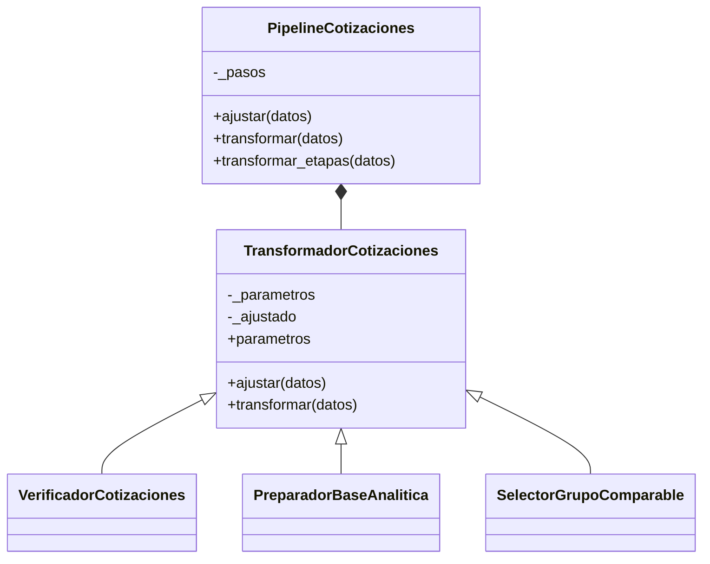

# F3 — Arquitectura y decisiones del núcleo algorítmico

## Alcance y continuidad

La Fase 3 reorganiza el preprocesamiento descriptivo de F2. Se mantienen el archivo
original, la moneda ARS, las reglas de elegibilidad, los faltantes complementarios,
las variables derivadas y la selección de condiciones de estancia. El punto de
partida es `main` en `06a4c5a66b5cd7b59e463c4144b0cc66dcae3643`, que incorpora el
cierre de F1/F2 mediante el PR #3. Los archivos de F1 y F2 se conservan.

No se incorporan modelos predictivos. La ausencia de una partición de entrenamiento
y prueba es coherente con el estudio descriptivo; si se desarrolla predicción, los
parámetros deberán aprenderse únicamente sobre entrenamiento.

## Componentes y responsabilidades

| Componente | Responsabilidad | Archivo |
|---|---|---|
| `TransformadorCotizaciones` | Validación común, control de ajuste y copia defensiva | `src/f3_transformadores.py` |
| `VerificadorCotizaciones` | Aplicar la lectura y elegibilidad ya verificadas en F2 | `src/f3_transformadores.py` |
| `PreparadorBaseAnalitica` | Conservar transformaciones de F2 y fijar límites IQR por tipo | `src/f3_transformadores.py` |
| `SelectorGrupoComparable` | Aprender fecha/duración por cobertura y mantenerlas al transformar | `src/f3_transformadores.py` |
| `PipelineCotizaciones` | Encadenar etapas por su interfaz común | `src/f3_pipeline.py` |
| `resumen_por_bucle` | Resumen inicial con filtrado por grupo | `src/f3_medicion.py` |
| `resumen_vectorizado` | Mismo resumen agrupando una vez y calculando cuartiles por grupo | `src/f3_medicion.py` |
| `comparar_implementaciones` | Igualdad previa, tiempo con `timeit` y memoria con `tracemalloc` | `src/f3_medicion.py` |
| `cargar_referencias_f2` | Verificar los CSV locales de F2 contra sus huellas | `src/f3_validacion.py` |
| `comprobar_equivalencia` | Distinguir igualdad estricta en memoria y equivalencia tras leer CSV | `src/f3_validacion.py` |

## Herencia, encapsulamiento y polimorfismo



Las tres clases hijas heredan los controles comunes. Las propiedades de parámetros
y registro devuelven copias profundas; modificarlas no cambia el estado del objeto.
El prefijo `_` expresa uso interno por convención de Python, sin constituir una
barrera de seguridad. El orquestador utiliza la misma llamada en todas las etapas:

```python
for paso in self._pasos:
    intermedio = paso.ajustar(intermedio).transformar(intermedio)
```

El ejemplo procede de `src/f3_pipeline.py`; los métodos `ajustar()` y `transformar()`
pueden probarse por separado. Se rechaza transformar sin ajuste previo y un reajuste
fallido deja el orquestador sin habilitar para transformar.

## Patrón de diseño y división funcional

Se aplica **método plantilla (Template Method)**: la clase base fija la secuencia de
validación, aprendizaje y aplicación; cada clase hija especializa `_aprender()` y
`_aplicar()`. Esta decisión evita duplicar controles de estado y copias defensivas
en cada transformación. El orquestador utiliza composición para separar el orden
del flujo de la implementación particular de las etapas.

La división funcional reemplaza una recursión innecesaria: las tablas no contienen
una jerarquía de profundidad desconocida y la secuencia de pasos es explícita. La
guía acepta recursividad o división funcional fundamentada. Las mediciones no se
mezclan con la carga ni con la transformación; pueden repetirse sin modificar datos.

## Parámetros conservados y límites del adaptador

Los límites IQR se aprenden por tipo de alojamiento; la fecha y duración se eligen
por cobertura, con desempate por fecha temprana y menor duración. Al transformar,
se aplican esos parámetros sin aprender otros nuevos. Si aparece un tipo sin límites
IQR aprendidos, el componente se detiene en lugar de fabricar un criterio.

El adaptador de la base reutiliza `preparar_base()` de F2 y sustituye sus marcas IQR
por las calculadas con los límites guardados. Esto conserva las reglas previas y
evita editar F2, aunque esa llamada realiza cálculos IQR intermedios que luego se
reemplazan. Las mediciones comparan los resúmenes, no acreditan una aceleración de
todo el preprocesamiento ni de la lectura del original.

## Comprobaciones y mediciones

1. Verificar el SHA-256 del original y de los tres CSV de F2.
2. Comparar vista y base en memoria con `assert_frame_equal(check_exact=True)`.
3. Comparar los tres resultados con los CSV de F2, usando sus tolerancias de lectura:
   `rtol=1e-12`, `atol=1e-7`, `check_dtype=False`.
4. Comprobar equivalencia de ambas implementaciones y de los resúmenes de F2:
   grupos y conteos exactos; mediana y cuartiles con `rtol=0` y `atol=1e-7 ARS`,
   por diferencias de redondeo binario entre las operaciones de pandas.
5. Medir cinco repeticiones con tres ejecuciones por repetición, con calentamiento
   previo y orden alternado; informar mínimo, mediana y máximo.
6. Medir separadamente tres picos de memoria rastreada por Python e informar mediana.
7. Conservar parámetros, tablas agregadas, pruebas y contexto real de ejecución.

Los tamaños son 250, 2.080 y 27.633 filas de la base elegible, obtenidos de una
permutación con semilla 2026. El costo de filtrar por cada uno de `k` grupos añade
trabajo proporcional a `n × k`; agrupar una vez evita esos filtros. Los cuartiles
añaden su propio costo. Las submuestras cambian de composición y no constituyen una
demostración empírica aislada de complejidad asintótica.

La elección registrada se basa en el menor tiempo mediano sobre el tamaño completo,
considerando también la diferencia de memoria. El mínimo se conserva como referencia
de menor interferencia. Si las mediciones resultan muy cercanas, la preferencia
requiere cautela; no se promete una mejora universal.

## Entrega a F4

| Archivo local, fuera de Git | Uso |
|---|---|
| `data/processed/base_cotizaciones_f3.csv` | Base elegible con las reglas de F2 |
| `data/processed/grupo_principal_f3.csv` | Comparaciones con fecha y duración iguales |
| `data/processed/grupo_sensibilidad_f3.csv` | Sensibilidad al ampliar las entradas al mismo mes |
| `data/processed/indicadores_tipo_f3.csv` | Codificación nominal de tipos |

F4 utilizará estos resultados y los parámetros registrados. La ampliación mensual
no corrige por inflación; la fecha de estancia no prueba una misma fecha de fijación
del precio. Los resultados mantienen un alcance descriptivo y no acreditan ingresos,
rentabilidad ni causalidad.

## Referencias

Las referencias completas y sus citas se incluyen en el notebook F3. Se utilizan
dos materiales de la Semana 2, documentación oficial de Python y pandas y el texto
de McKinney (2022). El patrón método plantilla se corresponde con Gamma, E., Helm,
R., Johnson, R., y Vlissides, J. (1994), *Design patterns: Elements of reusable
object-oriented software*, Addison-Wesley.
