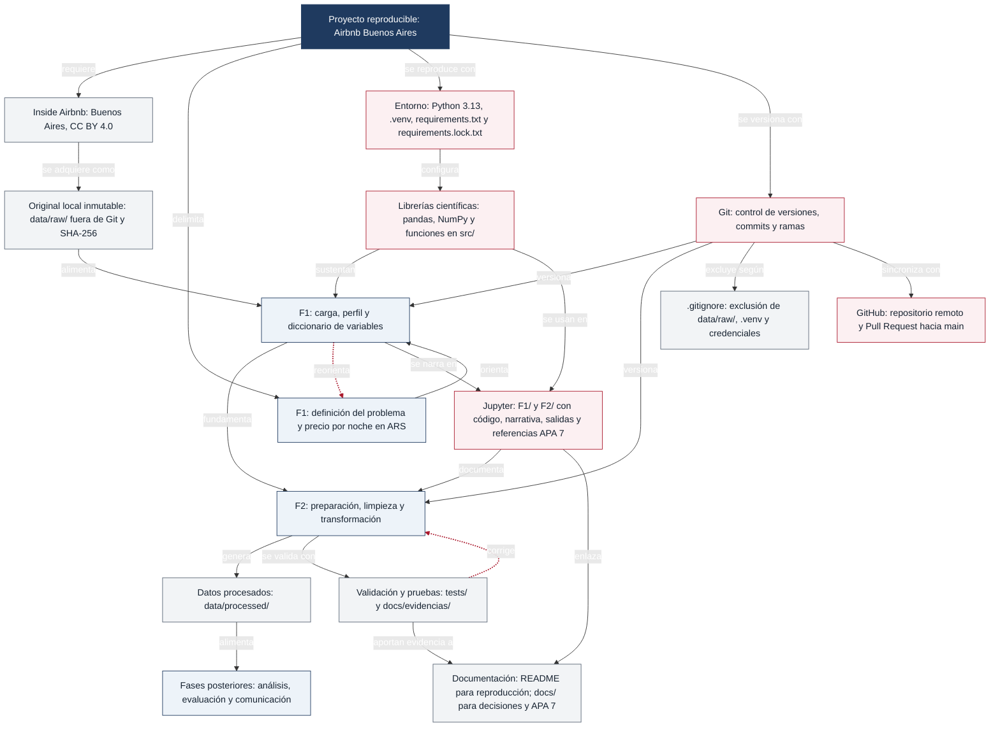

# Mapa conceptual: herramientas colaborativas y flujo reproducible

**Airbnb Buenos Aires | Fase 1: definición y orientación de la situación**

- **Institución:** Universidad Andrés Bello
- **Programa:** Magíster en Ciencia de Datos e Inteligencia Artificial
- **Asignatura:** MCDI500 - Programación para la Ciencia de Datos
- **Autor:** Carlos Santiago Vergara Andraes
- **Docente:** Omar Salinas
- **Fecha:** 24 de noviembre de 2026

## Problema y datos

¿Cómo varía el precio cotizado por noche en ARS según barrio, tipo y capacidad, considerando fecha y duración de estancia?

Inside Airbnb: 29.753 anuncios y 90 variables en listings.csv.gz. Unidad de análisis: anuncio. Licencia: CC BY 4.0 (Inside Airbnb, 2026). Variables numéricas, nominales, binarias, fechas y texto; incluye faltantes.

## Reflexión técnica

Se conserva el original y se vinculan funciones, notebooks y commits para que cada decisión tenga evidencia. Git registra versiones y GitHub permite revisar e integrar cambios (Chacon y Straub, 2014).

Se descarta imputar precios en la comparación principal: produciría tarifas no observadas. F2 deberá justificar faltantes, extremos y comparabilidad de fechas y noches. Se asumen moneda confirmada y categorías interpretables.

## Leyenda

- Azul oscuro: proyecto.
- Azul claro: etapas del flujo.
- Granate claro: herramientas y entorno.
- Gris: datos, documentos y evidencias.
- Recuadros: conceptos.
- Flechas continuas: relaciones etiquetadas.
- Flechas discontinuas granates: retornos por diagnóstico o validación.

## Commits proyectados

- `feat(f2): preparar datos y registrar reglas`.
- `test(f2): verificar casos y consistencia`.
- `docs: incorporar resultados y referencias`.

Los mensajes registrarán el motivo y el impacto de cada decisión. La integración a main se realizará mediante Pull Request.

## Referencias

Chacon, S., & Straub, B. (2014). *Pro Git* (2.ª ed.). Apress. https://git-scm.com/book/en/v2

Inside Airbnb. (2026). *Buenos Aires: Detailed listings* [Conjunto de datos; recurso 2026-09-23]. https://data.insideairbnb.com/argentina/ciudad-aut%C3%B3noma-de-buenos-aires/buenos-aires/2026-09-23/data/listings.csv.gz

## Mapa conceptual

